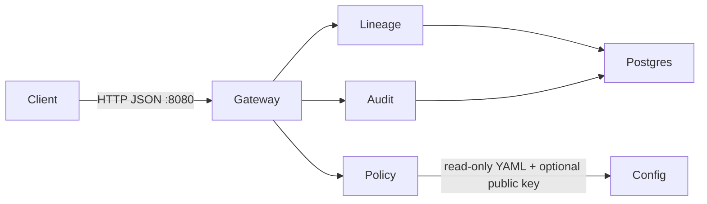

# Architecture

## System shape

The project runs four FastAPI REST services and PostgreSQL under Docker Compose. Only the gateway publishes a host port. Services communicate over the Compose network; lineage, audit, and policy services read configuration or data from PostgreSQL and mounted policy files.

The `mcp-*` names are historical service names. The current implementation does not speak the Model Context Protocol or use its SDK; the public interface is REST/JSON.

## Request flow

1. A client registers model ID, version, artifacts, owner, and metadata through `POST /mcp-lineage/register`.
2. A client submits evaluation data to `POST /mcp-policy/validate`. The policy service loads the YAML files, computes a weighted score, optionally verifies an AIBOM signature, and returns an allow/deny decision with reasons and elapsed time.
3. The caller records that decision at `POST /mcp-audit/log`. The audit service hashes the event with the preceding entry hash and persists the result.
4. Reviewers can read events or export JSON/CSV through the gateway.

The services are intentionally separate so a demo can show the boundary between registering evidence, evaluating rules, and recording decisions. The current stack does not coordinate those calls into an atomic workflow.

## Service responsibilities

| Component | Responsibility | State |
| --- | --- | --- |
| `mcp-gateway` | Directory, path allowlist, request forwarding, high-level demo endpoints | No durable state |
| `mcp-lineage` | Append model version and artifact metadata; look up model history | PostgreSQL `model_lineage` |
| `mcp-policy` | Load YAML, calculate weighted risk, apply require/deny checks, optional AIBOM verification | Read-only YAML and optional public key |
| `mcp-audit` | Append decision events and return JSON/CSV exports | PostgreSQL `audit_log` |
| `db` | Store lineage, audit events, and migration history | Named PostgreSQL volume |

## Evidence model

`model_lineage` stores a row per registration. `audit_log` stores the event, the prior event hash, and the new entry hash. A trigger blocks ordinary `UPDATE` and `DELETE` statements on audit rows. This detects broken links and discourages application-level edits; it does not protect against a privileged database operator who can alter the schema, disable triggers, or rewrite data.

Policy evidence is reproducible only when the caller preserves the submitted payload, exact policy files, risk matrix, public-key identity, and service version with the returned result. This repository does not yet persist a policy-file digest alongside each decision.

## Runtime and security boundaries

Compose health checks verify process readiness and database availability where applicable. Application containers use read-only root filesystems, a non-root account, dropped capabilities, and temporary filesystems. PostgreSQL owns the persistent writable volume. The gateway restricts service names, paths, forwarded headers, redirects, and upstream timeouts.

There is no built-in user authentication, authorization, tenant isolation, rate limiting, or TLS termination. The sample stack is for local evaluation on a trusted network, not direct public exposure.
