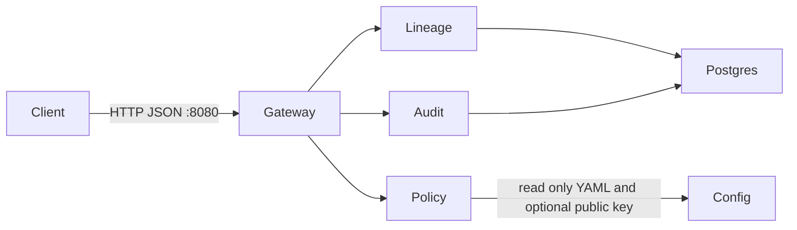

# Architecture

## The big picture

Docker Compose runs four FastAPI services and PostgreSQL. Only the gateway is reachable from your computer. The services talk to each other over the Compose network. The lineage and audit services store data in PostgreSQL. The policy service reads mounted policy files.

The `mcp` names are historical. The services do not speak the Model Context Protocol. Their interface is REST and JSON.

## How a decision flows

1. A client registers a model with `POST /mcp-lineage/register`. It sends the model ID, version, artifacts, owner, and metadata.
2. The client sends evaluation data to `POST /mcp-policy/validate`. The policy service loads the YAML files and calculates a weighted score. It can also check an AIBOM signature. It returns allow or deny with reasons and the time taken.
3. The client records that decision with `POST /mcp-audit/log`. The audit service hashes the event together with the previous hash and stores it.
4. Reviewers read the events, or export them as JSON or CSV, through the gateway.

The services are kept separate on purpose. That makes it clear where evidence is registered, where rules are checked, and where decisions are recorded. The stack does not tie the three calls into one all or nothing step. If one call fails, the caller must handle it.

## What each part does

| Component | Job | Where it keeps state |
| --- | --- | --- |
| `mcp-gateway` | Lists services, checks paths against an allowlist, forwards requests, and offers demo endpoints | None |
| `mcp-lineage` | Adds model versions and artifacts, and looks up a model's history | PostgreSQL table `model_lineage` |
| `mcp-policy` | Loads YAML, calculates risk, applies required and denied checks, and can verify AIBOM signatures | Read only YAML files and an optional public key |
| `mcp-audit` | Adds decision events and exports them as JSON or CSV | PostgreSQL table `audit_log` |
| `db` | Stores lineage, audit events, and migration history | A named PostgreSQL volume |

## How evidence is stored

`model_lineage` has one row for each registration. `audit_log` stores each event, the hash of the event before it, and its own hash. A database trigger blocks normal `UPDATE` and `DELETE` statements on audit rows.

This helps you notice broken links and stops casual edits from the application. It does not stop a database administrator who can change the schema, turn off triggers, or rewrite data.

You can only reproduce a policy decision if you keep the submitted payload, the exact policy files, the risk matrix, the public key identity, and the service version along with the result. The project does not yet store a digest of the policy files with each decision.

## Runtime and security

Compose health checks confirm that each service is ready and that the database can be reached. Application containers use a read only filesystem, run as a normal user, drop extra privileges, and use temporary storage where needed. PostgreSQL owns the only persistent writable volume. The gateway limits which services, paths, headers, redirects, and wait times it allows.

There is no built in login, permission system, customer separation, rate limiting, or TLS. This stack is for local testing on a trusted network. Do not expose it directly to the public internet.
